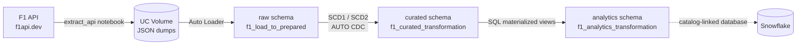
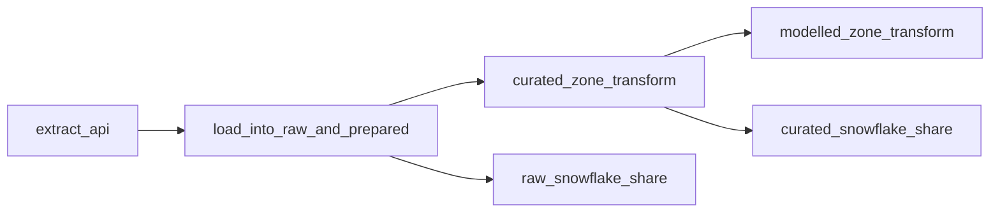
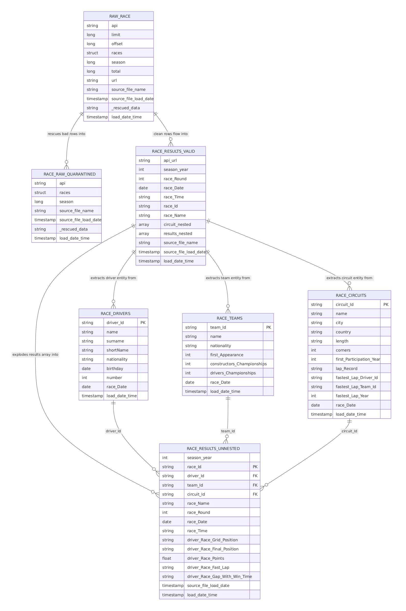
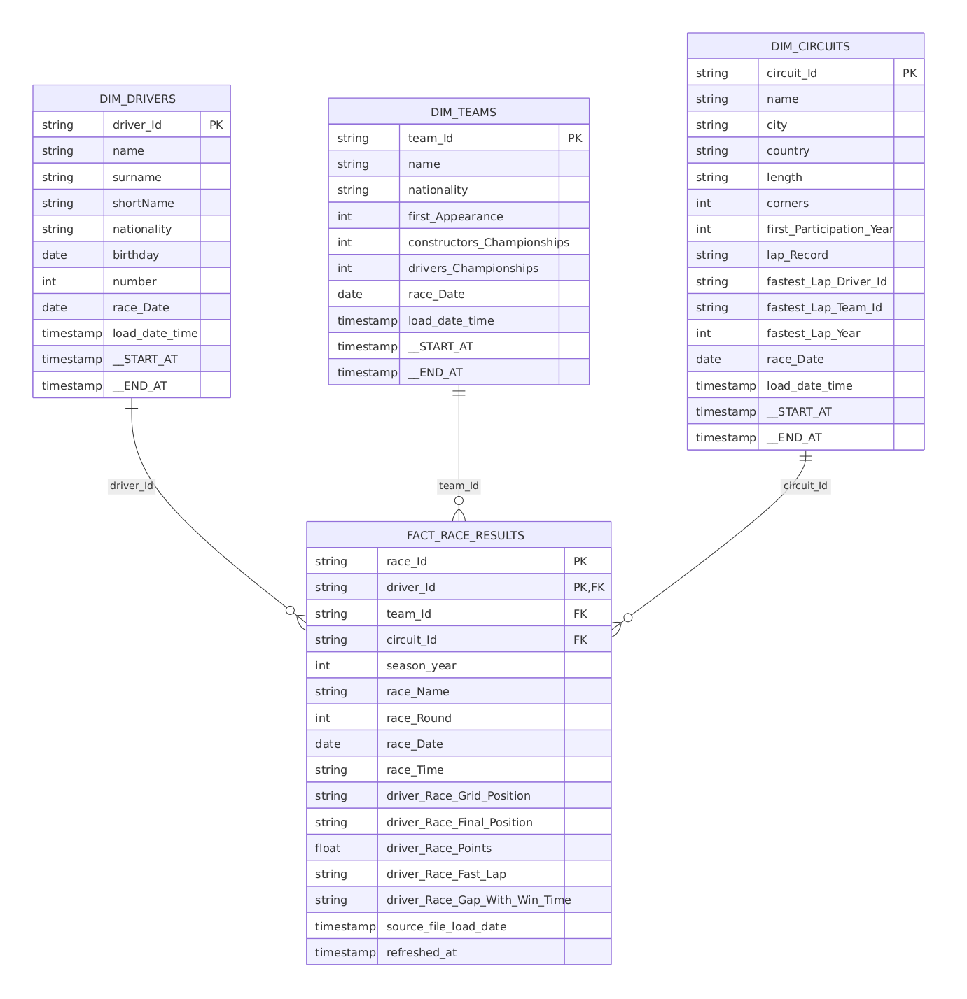
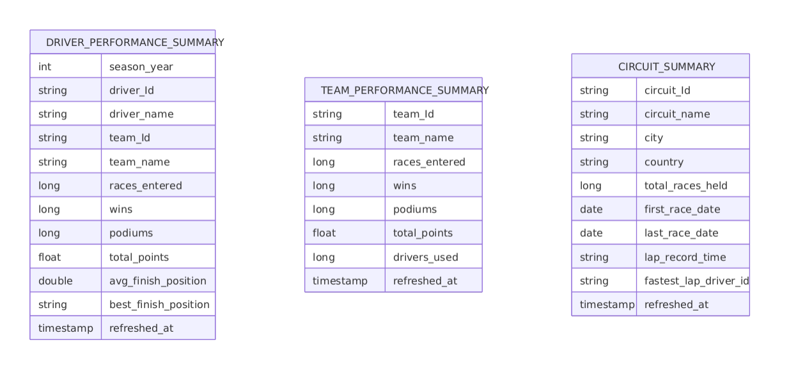

# F1 Databricks Lakehouse

An end-to-end Formula 1 race data pipeline built on Databricks, using **Spark Declarative Pipelines** (Lakeflow) and the **Medallion Architecture**. Race results are pulled from a public F1 API, then flow through raw → curated → analytics zones, ending in queryable driver, team, and circuit performance summaries.

Deployed entirely as a [Databricks Asset Bundle](https://docs.databricks.com/aws/en/dev-tools/bundles/) — one `databricks bundle deploy` stands up the schemas, the raw volume, three Lakeflow pipelines, and the orchestrating job (the catalogs themselves come from Terraform in `prod`).

## Architecture



Each zone is deployed as its own Lakeflow pipeline **and lives in its own Unity Catalog
catalog** (`f1_raw`, `f1_curated`, `f1_analytics` in `prod`). A single Databricks Job
(`f1_ingest_and_transform_workflow`) runs the pipelines in sequence, with a
Snowflake sync task after the raw and curated layers, running in parallel with the *next*
layer's transform rather than blocking it (syncing raw to Snowflake has no reason to wait
on the curated transform, for example). The gold layer has no sync task: Snowflake reads
its catalog through a catalog-linked database, which discovers and refreshes the tables on
its own:



| Zone | Catalog (`prod`) | Pipeline | Key tables |
|---|---|---|---|
| Raw | `f1_raw` | `f1_load_to_prepared` | `raw_race`, `race_raw_quarantined`, `race_results_valid`, `race_results_unnested`, `race_drivers`, `race_teams`, `race_circuits` |
| Curated | `f1_curated` | `f1_curated_transformation` | `dim_drivers` (SCD2), `dim_teams` (SCD2), `dim_circuits` (SCD2), `fact_race_results` (SCD1) |
| Analytics | `f1_analytics` | `f1_analytics_transformation` | `driver_performance_summary`, `team_performance_summary`, `circuit_summary` |

## Data model

Each medallion zone has its own ER diagram below, reflecting the tables that pipeline actually produces.

### Raw layer

`f1_load_to_prepared` — Auto Loader ingestion, quarantine, and flattening of the source JSON.

This project follows Databricks' documented **["Decouple ingestion with a scheduled job and Auto Loader"](https://docs.databricks.com/aws/en/ldp/api-ingestion#pattern-decoupled-autoloader)** pattern for pulling data from an arbitrary API. `extract_f1_source_data.ipynb` runs as a separate job task, calls `f1api.dev`, and lands the raw JSON in a Unity Catalog volume — it never runs inside the pipeline itself. `f1_load_to_prepared`'s `raw_race` table only reads files from that volume with Auto Loader. The pipeline never talks to the API, and the job never touches transformation logic. That separation is what buys Auto Loader's exactly-once file tracking and keeps `f1api.dev`'s pagination/rate-limit handling out of the declarative pipeline code entirely.

Every raw table carries two timestamps, and the distinction matters: `load_date_time` is stamped with `current_timestamp()` at pipeline run time, so every row in the same Auto Loader micro-batch gets an identical value. `source_file_load_date` comes from Auto Loader's `_metadata.file_modification_time` instead — the file's own timestamp — and is what downstream SCD2 sequencing actually relies on to tell rows apart within a batch.



### Curated layer

`f1_curated_transformation` — the conformed star schema. Dimensions are maintained as **SCD Type 2** (full history, via `dp.create_auto_cdc_flow`), the fact table as **SCD Type 1** (latest state only).

Dimension SCD2 flows sequence on `race_Date`, not a load timestamp — `race_Date` reflects when the underlying event actually happened, so a driver's record updates in race-chronological order regardless of the order files happen to get processed in.



### Modelled (analytics) layer

`f1_analytics_transformation` — gold materialized views built off the curated fact and dimension tables (`CREATE OR REFRESH MATERIALIZED VIEW` in `src/transformations/modelled/*.sql`). A materialized view's Iceberg metadata normally attaches only to its hidden internal backing table, not the queryable name — which is exactly what external readers like Snowflake need. Databricks' external-access-for-pipelines feature closes that gap: the `pipelines.externalMetadata.enabled` table property (set in `TBLPROPERTIES` alongside the usual UniForm properties) makes Unity Catalog serve Iceberg metadata for the MV's queryable name itself.



## Repository structure

```
.
├── AGENTS.md                                  # Guidance for AI agents (project rules, gotchas)
├── CLAUDE.md                                  # Imports AGENTS.md
├── README.md
├── databricks.yml                             # Bundle definition, dev/prod targets & variables
├── docs/images/                               # ER diagrams used in this README
├── fixtures/
├── resources/
│   ├── databricks_entity_creation/
│   │   └── base_objects_creation.yml          # One schema per zone (each in its zone's catalog) + raw UC volume
│   ├── job_definitions/
│   │   └── f1_ingest_and_transform_workflow.yml   # The orchestrating job
│   └── transformation_pipelines/
│       ├── f1_load_to_prepared.yml            # Raw pipeline definition
│       ├── f1_curated_transformation.yml      # Curated pipeline definition
│       └── f1_analytics_transformation.yml    # Analytics pipeline definition
├── src/
│   ├── ingestion/
│   │   └── extract_f1_source_data.ipynb       # Pulls race data from f1api.dev
│   ├── transformations/
│   │   ├── prepared/
│   │   │   └── race_data_load_raw_and_prepared.py   # Bronze: Auto Loader ingestion + flattening
│   │   ├── curated/
│   │   │   └── race_data_curated.py           # Silver: SCD1/SCD2 dimensional model
│   │   └── modelled/
│   │       ├── driver_performance_summary.sql # Gold: driver aggregates
│   │       ├── team_performance_summary.sql   # Gold: team aggregates
│   │       └── circuit_summary.sql            # Gold: circuit aggregates
│   └── utility/
│       ├── utiltiy_notebook.ipynb                     # Legacy fallback: CREATE CATALOG IF NOT EXISTS
│       ├── create_snowflake_catalog_integration.ipynb # One-time: one Snowflake catalog integration per zone catalog
│       ├── sync_to_snowflake.ipynb                    # Per-run: creates/refreshes the raw and curated ICEBERG TABLEs
│       └── snowflake_sync_config.json                 # Declarative source→target mapping the sync notebook reads (raw and curated only)
└── terraform/                                 # Separate project and state — see terraform/README.md
    ├── aws_storage.tf                         # S3 bucket + IAM role for the catalogs' storage
    ├── databricks_catalog.tf                  # Storage credential, external location, one catalog per zone
    ├── databricks_access.tf                   # Service principal, per-catalog grants, secret-scope ACL
    ├── databricks_secrets.tf                  # Secret scope the Snowflake notebooks read
    ├── snowflake.tf / snowflake_data.tf       # Service user, role, grants; warehouse, database, schemas
    ├── secrets.tf / kms.tf                    # Secrets Manager secret + customer-managed KMS key
    ├── providers.tf / variables.tf / outputs.tf
    └── terraform.tfvars.example               # Copy to terraform.tfvars (gitignored)
```

## Prerequisites

- A Databricks workspace with Unity Catalog enabled
- [Databricks CLI](https://docs.databricks.com/dev-tools/cli/install.html) v0.240+
- Permissions to create catalogs, schemas, and volumes

## Setup

### 1. Create a personal access token

1. In your Databricks workspace, go to **Profile → Settings**, then under the **User** section open the **Developer** subsection. Click **Manage** next to **Access tokens**.
2. Click **Generate new token**, enter a **Lifetime (days)**, and set **Scope** to **Other APIs**.
3. For **API scope(s)**, choose **All APIs**.
4. Copy the generated token — you won't be able to view it again.

### 2. Clone and authenticate

```bash
git clone https://github.com/vikneshwara-r-b/databricks-snowflake-iceberg-federation.git
cd databricks-snowflake-iceberg-federation
databricks auth login --host https://<your-workspace-url>
```

When prompted, paste in the personal access token generated above.

### 3. Review variables

Check `databricks.yml` for the `dev` target — by default every zone deploys into the `workspace` catalog (dev can't create catalogs), in `raw` / `curated` / `analytics` schemas. Adjust the `raw_catalog` / `curated_catalog` / `analytics_catalog` variables or schema names as needed. The workspace itself is whichever one you authenticated against in Step 2 — `databricks.yml` doesn't pin a `host`, so switching workspaces is just a matter of re-running `databricks auth login` against a different one.

| Bundle variable | `dev` | `prod` | Purpose |
|---|---|---|---|
| `raw_catalog` | `workspace` | `f1_raw` | Raw zone's catalog; also holds the raw landing volume |
| `curated_catalog` | `workspace` | `f1_curated` | Curated zone's catalog |
| `analytics_catalog` | `workspace` | `f1_analytics` | Gold zone's catalog — the one Snowflake's catalog-linked database links to |
| `raw_zone_schema_name`, `curated_zone_schema_name`, `analytics_zone_schema_name` | `raw`, `curated`, `analytics` | same | Schema inside each zone's catalog |
| `raw_volume_name`, `raw_volume_subdir_path` | `f1_api_export`, `race_results_dumps` | same | Where the extract notebook lands JSON |
| `full_refresh_all` | `"false"` | `"false"` | Deploy-time switch for a full refresh of all three pipelines (see below) |
| `job_run_as_application_id` | — | looked up | Resolved at deploy time from the `svc-f1-analytics-automation` service principal's name; never hardcode it |

The `prod` catalog names must match Terraform's `raw_catalog_name`, `curated_catalog_name` and `catalog_name` (the gold catalog). They are copied by hand, not wired between the two tools.

### 4. Create the catalog

The bundle creates the `raw` / `curated` / `analytics` **schemas** — each in its own zone's catalog (`raw_catalog` / `curated_catalog` / `analytics_catalog`) — and the raw volume (in the raw catalog), see `resources/databricks_entity_creation/base_objects_creation.yml` — but it does not create the **catalogs** themselves.

- **`dev` target:** no action needed. It uses the built-in `workspace` catalog, which every Unity Catalog–enabled workspace already has.
- **`prod` target (or any custom catalog name):** the catalog is now provisioned by Terraform (`terraform/`), with external S3 storage — see `terraform/README.md` for setup and the ["Deploying to production"](#deploying-to-production) steps below. This replaces the old `src/utility/utiltiy_notebook.ipynb`-based manual step for `prod`; that notebook is kept around only as a legacy/manual fallback (e.g. for non-AWS environments) and does exactly one thing: `CREATE CATALOG IF NOT EXISTS <catalog_name>`.

### 5. Validate and deploy

```bash
databricks bundle validate -t dev
databricks bundle deploy -t dev
```

This creates the schemas and volume, the three Lakeflow pipelines, and the orchestrating job (prefixed `[dev <your_databricks_username>]` in development mode).

### 6. Run the pipeline

```bash
databricks bundle run f1_ingest_and_transform_workflow -t dev
```

Optionally override job parameters to pull a different race:

```bash
databricks bundle run f1_ingest_and_transform_workflow -t dev \
  --params f1_season_year=2023,f1_season_round=5
```

### 7. Query the results

```sql
SELECT driver_name, team_name, wins, podiums, total_points
FROM workspace.analytics.driver_performance_summary
ORDER BY total_points DESC;
```

## Deploying to production

Production deploys the `prod` target into one dedicated catalog per medallion zone —
`f1_raw`, `f1_curated`, `f1_analytics` (all backed by external S3 storage) — and, on top
of that, makes the gold catalog readable directly from Snowflake through a
**catalog-linked database**, and raw/curated as individual Iceberg tables (UniForm +
Iceberg REST Catalog + credential vending — see
["How the Snowflake federation works"](#how-the-snowflake-federation-works) below for
the architecture). Terraform here is **one project, one state** — AWS storage, the
three Unity Catalog catalogs, the Databricks service principal, the Snowflake role, and the
Secrets Manager secret, all from a single `terraform apply`.

### 1. Prerequisites

- A named AWS CLI profile and a named Databricks CLI profile, both pointed at the
  right account/workspace: `databricks auth login --host https://<prod-workspace-url> --profile <profile-name>`.
- A metastore admin must enable Unity Catalog's `external_access_enabled` setting on
  the metastore (Public Preview) — required for credential vending to work at all;
  without it, Snowflake fails with "Please ensure that the catalog vends credentials."
  It's a *workspace* Catalog Explorer setting, not an Account Console one (gear icon
  → Metastore → Details → External data access), visible only to sufficiently
  privileged users and off by default for security — the CLI is more reliable. Get
  your metastore id with `databricks metastores current --profile
  <your-databricks-cli-profile>`, then:
  `databricks metastores update <metastore-id> --external-access-enabled=true
  --profile <your-databricks-cli-profile>`. Deliberately kept manual rather than
  Terraform-managed, since the metastore is shared across workspaces this project
  doesn't own (see `terraform/README.md` Prerequisites for the full rationale).
- [Terraform](https://developer.hashicorp.com/terraform/install) >= 1.6, and the AWS
  CLI configured with the profile above.
- Whoever runs `databricks bundle deploy -t prod` needs the **"Service principal:
  User"** role on `svc-f1-analytics-automation` (the SP the job/pipelines
  `run_as`) — being a workspace admin, or the user who created the SP, does **not**
  imply this role. `terraform apply` grants it automatically (to whichever identity
  `var.databricks_profile` authenticates as), via
  `databricks_access_control_rule_set.snowflake_reader_user`; see
  `terraform/README.md` Prerequisites item 4 for the manual fallback and the
  authoritative-overwrite caveat on that resource.

### 2. Set up the Snowflake admin identity Terraform authenticates as

Terraform needs a Snowflake identity of its own to bootstrap everything else — this is
the one Snowflake credential that genuinely can't be automated, since it's what
Terraform uses to create everything downstream (including the sync service user).
Rather than using your own personal account, create a dedicated, generically-named
service user (key-pair auth only — no username/password anywhere in this setup) as a
human `ACCOUNTADMIN`, one time:
```bash
openssl genrsa 2048 | openssl pkcs8 -topk8 -inform PEM -out admin_rsa_key.p8 -nocrypt
openssl rsa -in admin_rsa_key.p8 -pubout -out admin_rsa_key.pub
grep -v -e '^-----' admin_rsa_key.pub | tr -d '\n'   # paste into the CREATE USER below
```
```sql
CREATE USER SVC_IAC_ADMIN
  TYPE = SERVICE
  RSA_PUBLIC_KEY = '<public key body from above>'
  COMMENT = 'Dedicated infrastructure-automation identity';

GRANT ROLE SECURITYADMIN TO USER SVC_IAC_ADMIN;
GRANT ROLE SYSADMIN TO USER SVC_IAC_ADMIN;
GRANT CREATE INTEGRATION ON ACCOUNT TO ROLE SECURITYADMIN WITH GRANT OPTION;
```
It only needs these two roles, not `ACCOUNTADMIN` itself — the last grant is a
one-time exception needed because Snowflake restricts granting account-level
privileges like `CREATE INTEGRATION` to `ACCOUNTADMIN` or a role holding it
`WITH GRANT OPTION`, not just `MANAGE GRANTS`. Full detail in
[`terraform/README.md`](terraform/README.md#prerequisites-one-time-manual).
Have `SVC_IAC_ADMIN` and `admin_rsa_key.p8`'s contents ready for the next step — they
go into `terraform.tfvars` as `snowflake_admin_user` / `snowflake_admin_private_key_pem`.

### 3. Apply Terraform

```bash
cd terraform
cp terraform.tfvars.example terraform.tfvars   # fill in — this file holds raw key material
terraform init
terraform apply
```

This creates the S3 bucket and IAM role backing the catalogs' storage, the Secrets
Manager secret (one secret holding the admin identity from step 2 and a **Snowflake
service user Terraform generates and creates itself** — key pair included, see
[`terraform/README.md`](terraform/README.md#the-snowflake-service-user-and-its-role-fully-automated)
— no manual `CREATE USER` needed), the storage credential, external location, the
three zone catalogs themselves (`f1_raw`, `f1_curated`, `f1_analytics`, one S3 prefix
each), the Databricks service principal + a **catalog-level** grant on each of them
(`USE CATALOG`/`USE SCHEMA`/`SELECT`/`EXTERNAL USE SCHEMA` plus the job's
`MODIFY`/`CREATE TABLE`/`CREATE MATERIALIZED VIEW`/volume privileges, which cascade to
every schema inside the catalog — including ones that don't exist yet), a second
catalog-level grant giving **whichever identity Terraform authenticates as**
`ALL_PRIVILEGES` on all three catalogs (otherwise that human can't read the tables the
service principal's pipelines create — see
[Access model](#access-model--who-can-do-what)), the Snowflake role + grants, the
Snowflake warehouse/database/schemas, and the Databricks secret scope the notebooks read
from. One apply, no second pass needed — granting at the catalog level means nothing
here has to wait on the DAB bundle to create anything first. Delete/secure
`terraform.tfvars` once applied.

### 4. Deploy the bundle, bootstrap the integrations and the linked database once, then run

```bash
cd ..
databricks bundle deploy -t prod
```

Run `src/utility/create_snowflake_catalog_integration.ipynb` **manually, once** in the
workspace — it creates one Snowflake catalog integration per zone catalog (and lets
`SYSADMIN` use the analytics one, for the next step). Not a job task, since it only needs
to exist once; skipping it means the job's sync tasks fail with no integration to create
Iceberg tables against, and the gold tables can't be linked.

**Before running it on serverless compute, install `snowflake-connector-python` yourself.**
Unlike the sync job (which declares it in its `snowflake_sync_env` environment), this
notebook isn't a job task, so nothing installs it — the first code cell fails with
`ModuleNotFoundError: No module named 'snowflake'` otherwise. Add it as a dependency in the
notebook's *Environment* side panel, or put `%pip install snowflake-connector-python` in a
cell at the top.

Then create the gold zone's **catalog-linked database**, once, in Snowflake as a human
holding `SYSADMIN` (e.g. a Snowsight worksheet). `SYSADMIN` already has `CREATE DATABASE`
by default and is Snowflake's conventional database owner, so no account-level privilege
is granted to `SECURITYADMIN` or to the sync service role for this — which is also why the
notebook above doesn't create it. Run it after `bundle deploy` (the `analytics` schema
must exist):

```sql
USE ROLE SYSADMIN;
CREATE DATABASE IF NOT EXISTS F1_ANALYTICS_LINKED
  LINKED_CATALOG = (
    CATALOG = 'uc_f1_analytics_iceberg',
    ALLOWED_NAMESPACES = ('analytics'),   -- skips information_schema (not Iceberg tables)
    ALLOWED_WRITE_OPERATIONS = NONE,      -- read-only; see below
    SYNC_INTERVAL_SECONDS = 60
  );
```

`ALLOWED_WRITE_OPERATIONS = NONE` matters: the default is `ALL`, and with it a `DROP
ICEBERG TABLE` in Snowflake also deletes the table and its data in Databricks. No external
volume is needed — the integration uses vended credentials. The database is owned by
`SYSADMIN` (so `ACCOUNTADMIN` can query it); the sync service role can't see it, and any
other consumer needs grants, e.g. via a database role (`CREATE DATABASE ROLE
F1_ANALYTICS_LINKED.analyst; GRANT USAGE ON SCHEMA ...; GRANT SELECT ON ALL ICEBERG TABLES
IN SCHEMA ... TO DATABASE ROLE ...;`).

```bash
databricks bundle run f1_ingest_and_transform_workflow -t prod
```

This creates the `raw`/`curated`/`analytics` schemas (and the raw volume) in the
catalogs Terraform just created, runs the three Lakeflow pipelines, and — right after the
raw and curated ones — runs that layer's `{raw,curated}_snowflake_share` task, which
creates/refreshes that layer's `ICEBERG TABLE` objects against the integration from the
step above. The gold tables need no task: the catalog-linked database picks them up on
its own (every `SYNC_INTERVAL_SECONDS`, 60 by default here), so they appear in Snowflake
about a minute after the analytics pipeline first creates them.

#### Forcing a full refresh of all three pipelines

Normal runs are incremental. To force every Lakeflow pipeline to fully refresh,
deploy with the `full_refresh_all` bundle variable set, run the job, then redeploy
without it:

```bash
databricks bundle deploy -t prod --var="full_refresh_all=true"
databricks bundle run f1_ingest_and_transform_workflow -t prod
databricks bundle deploy -t prod        # back to incremental (the default is false)
```

This is a **deploy-time** flag, not a runtime one, so it costs two deploys per use.
That is a Databricks Jobs constraint rather than a shortcut: `pipeline_task.full_refresh`
is a boolean field that does not accept `{{job.parameters.x}}` substitution, and the
legacy `pipeline_params` override is rejected on jobs that declare job-level
`parameters:`, which this job does. Both were confirmed against the live API.

One consequence worth knowing: a full refresh rebuilds each table's underlying
storage, which changes its Iceberg table UUID. Snowflake's existing `ICEBERG TABLE`
objects are pinned to the previous UUID, so `ALTER ICEBERG TABLE ... REFRESH` fails
afterwards. For the raw and curated zones, `sync_to_snowflake.ipynb` detects that
specific error and drops and recreates the affected Snowflake table automatically, so
those sync tasks recover on their own. The gold zone has no such code path: per
Snowflake's documentation a table whose UUID no longer matches is dropped from the
catalog-linked database, and whether the next discovery poll re-adds it unattended has
not been tested here.

### 5. Verify

```bash
databricks catalogs list    # f1_raw, f1_curated, f1_analytics
databricks storage-credentials get <storage_credential_name>   # from terraform output
aws iam get-role --role-name uc-f1_analytics-storage-role --profile <aws-profile>
# your own access to a pipeline-created (service-principal-owned) table:
databricks grants get-effective table f1_analytics.analytics.driver_performance_summary
```

In Databricks SQL, confirm UniForm persisted:

```sql
SHOW TBLPROPERTIES f1_analytics.analytics.driver_performance_summary;
```

In Snowflake:

```sql
SHOW CATALOG INTEGRATIONS;
-- Gold, through the catalog-linked database (as SYSADMIN or ACCOUNTADMIN):
SHOW ICEBERG TABLES IN DATABASE F1_ANALYTICS_LINKED;
SELECT * FROM F1_ANALYTICS_LINKED.analytics.driver_performance_summary LIMIT 10;
-- Raw and curated, as individually synced Iceberg tables:
SHOW ICEBERG TABLES IN SCHEMA UC_ICEBERG_SYNC.CURATED;
```

Full prerequisite detail, the exact Snowflake service-user setup commands, and the list
of still-unverified details (whether the catalog-linked database discovers Lakeflow
materialized views, its behaviour after a full refresh, the Public Preview catalog
integration syntax) are all in [`terraform/README.md`](terraform/README.md).

## How the Snowflake federation works

Nearly every table across all three zone catalogs — `f1_raw` (6 of 7; `race_raw_quarantined`
is deliberately excluded, see below), `f1_curated` (4), and `f1_analytics` (3 gold tables:
`driver_performance_summary`, `team_performance_summary`, `circuit_summary`) — is
readable directly from Snowflake, following [Databricks' UniForm + Iceberg REST Catalog pattern](https://www.databricks.com/blog/read-unity-catalog-tables-in-snowflake):

1. Every synced table has UniForm enabled plus `pipelines.externalMetadata.enabled = 'true'` (`table_properties`/`TBLPROPERTIES` in `src/transformations/{prepared,curated,modelled}/*`). That property is what makes Unity Catalog serve Iceberg metadata for each table's queryable name — for the gold layer's materialized views specifically, Iceberg metadata otherwise attaches only to the MV's hidden internal backing table, not the name Snowflake queries, so without this property Snowflake sees "not an Iceberg compatible table" even though UniForm is otherwise correctly enabled.
2. `terraform/` provisions a Databricks service principal (OAuth M2M) with `EXTERNAL USE SCHEMA` (on each zone catalog) and `EXTERNAL USE LOCATION` (on the shared external location) grants for Unity Catalog's credential vending, plus `MODIFY`/`CREATE TABLE`/`CREATE MATERIALIZED VIEW`/`READ VOLUME`/`WRITE VOLUME` so the same principal can also run the job (see below) — `CREATE MATERIALIZED VIEW` is a separate privilege from `CREATE TABLE`, required specifically for the gold layer; the three zone catalogs and the AWS storage they share; a single KMS-encrypted Secrets Manager secret holding every Snowflake credential involved; and a Databricks secret scope holding everything the next step needs.
3. `src/utility/create_snowflake_catalog_integration.ipynb` creates the Snowflake-side catalog integrations — one per zone catalog, since a REST integration's `CATALOG_NAME` is a single catalog. Run manually, once, not part of any job. A human `SYSADMIN` then creates the **catalog-linked database** over the gold catalog's integration (see the deploy steps above; deliberately not done by the notebook or Terraform, so no account-level `CREATE DATABASE` is granted to any role). The linked database (`CREATE DATABASE ... LINKED_CATALOG = (CATALOG = 'uc_f1_analytics_iceberg', ALLOWED_NAMESPACES = ('analytics'), ALLOWED_WRITE_OPERATIONS = NONE, ...)`) auto-discovers every table in the gold schema and re-polls Unity Catalog on `SYNC_INTERVAL_SECONDS`, so the gold layer needs no per-table sync step. It is deliberately **read-only**: with the default `ALLOWED_WRITE_OPERATIONS = ALL`, dropping a table in Snowflake would also delete it, and its data, in Databricks. It needs no external volume because the integration uses vended credentials.
4. The `f1_ingest_and_transform_workflow` job runs a `{raw,curated}_snowflake_share` task right after each of those layers' own pipelines (not once at the end) — two invocations of the same `src/utility/sync_to_snowflake.ipynb` notebook, each passed a different `layer` and `catalog_name` widget value (the layer's own catalog). The analytics/gold layer has no such task — the catalog-linked database from step 3 covers it. Each one connects to Snowflake as the same dedicated service user (key-pair auth) to create/refresh an `ICEBERG TABLE` for every entry under that layer's key in `src/utility/snowflake_sync_config.json` — the declarative mapping of source table → target Snowflake schema/table that replaced the earlier gold-only, hardcoded table list. A Snowflake Iceberg table backed by an external REST catalog always mirrors its source's full schema (Snowflake has no column-subset option for this table type), so the config has no column list — it's purely a sync target list. `race_raw_quarantined` has no entry under `raw` — quarantined/rejected records aren't meant to be externally readable. Target schemas (`RAW`/`CURATED`) are created by Terraform (`terraform/snowflake_data.tf`). An already-existing table only actually gets refreshed (`ALTER ICEBERG TABLE ... REFRESH`) if its Databricks source actually changed in the layer's pipeline's latest update — one `event_log(pipeline_id)` call per layer (`GROUP BY flow_name`, the `pipeline_id` passed in directly from the job's own `resources.pipelines.*.id`), not one call per table and not a custom state table, using different signals for streaming tables (incremental row-count metrics) versus materialized views (the `planning_information` event's chosen maintenance technique — an MV's `num_output_rows` is always its full recomputed row count, so it's useless as a change signal on its own). A newly-created table is always refreshed once regardless.
5. The job itself runs as a dedicated Databricks service principal, not whichever human deploys the bundle (`run_as` on the `prod` target in `databricks.yml`) — reusing the same OAuth M2M service principal from step 2 rather than a separate job-runner identity, so its catalog/volume/secret-scope grants cover both what Snowflake's integration needs and what the job's own notebook/pipeline tasks need. `run_as` only changes who *executes* the job, though — it doesn't grant that identity access to the workspace files (notebooks) the bundle deploys, which otherwise stay owned by whoever ran `databricks bundle deploy`. The `prod` target's top-level `permissions` block grants the SP and the deploying user (`${workspace.current_user.userName}`, resolved at deploy time — no name is hardcoded) `CAN_MANAGE` on everything the bundle deploys, resources and files alike — without it, the job fails at run time with "Unable to access the notebook ... lacks the required permissions." That block is a *workspace* ACL on the job, pipelines and notebooks, not a data privilege: because the pipelines run as the service principal, it owns every table they create, and the deploying human can only read them through the catalog-level grant Terraform gives the identity it authenticates as (see [Access model](#access-model--who-can-do-what)).

## Access model — who can do what

Three separate permission systems are involved; mixing them up is the usual source of "permission denied" surprises.

| Identity | Where | What it can do | Defined in |
|---|---|---|---|
| `svc-f1-analytics-automation` (Databricks service principal) | Unity Catalog | Owns every table the pipelines create (`run_as`); `SELECT`/`MODIFY`/`CREATE TABLE`/`CREATE MATERIALIZED VIEW`/volume access and `EXTERNAL USE SCHEMA` on all three catalogs; `EXTERNAL USE LOCATION` on the external location; `READ` on the Snowflake secret scope. Also the OAuth identity Snowflake's catalog integrations authenticate as. | `terraform/databricks_access.tf` |
| Whoever Terraform authenticates as (`var.databricks_profile`) | Unity Catalog | `ALL_PRIVILEGES` on all three catalogs (inherited by every current and future object), plus the "Service principal: User" role needed to deploy with `run_as`. No name is hardcoded; it is looked up at plan time. | `terraform/databricks_access.tf` |
| The deploying user and the service principal | Workspace | `CAN_MANAGE` on the bundle's job, pipelines and deployed notebooks (`prod` only). A workspace ACL, **not** a data privilege. | `databricks.yml` (`permissions`) |
| `SVC_IAC_ADMIN` | Snowflake | Terraform's own login (`SECURITYADMIN` + `SYSADMIN`). Holds `CREATE INTEGRATION` `WITH GRANT OPTION` (one-time manual grant). | `README.md` / `terraform/README.md` prerequisites |
| `UC_ICEBERG_READER` (assumed by the sync service user) | Snowflake | Creates and owns the catalog integrations (`CREATE INTEGRATION`) and the raw/curated `ICEBERG TABLE`s in `UC_ICEBERG_SYNC`. Deliberately holds **no** account-level `CREATE DATABASE`. | `terraform/snowflake.tf` |
| `SYSADMIN` | Snowflake | Owns `UC_ICEBERG_SYNC` (created through Terraform's `sysadmin` provider alias) and `F1_ANALYTICS_LINKED` (created by a human). Inherits `UC_ICEBERG_READER`'s privileges through the role hierarchy. | `terraform/snowflake_data.tf`, deploy step 4 |

The Unity Catalog grants live in an **authoritative** `databricks_grants` resource, so a manual `GRANT` (SQL or UI) on these catalogs is reverted by the next `terraform apply`; change them in Terraform.

## Operations and recovery

- **Migrating from the single-catalog layout.** If you deployed the earlier version (all three zones as schemas in `f1_analytics`), the move to one catalog per zone is a clean rebuild: the bundle drops and recreates the `raw` and `curated` schemas, the raw volume and the pipelines, so re-run the job to re-extract the data. Also drop the old per-table `ICEBERG TABLE` objects in `UC_ICEBERG_SYNC.RAW`/`CURATED` (and the old `ANALYTICS` schema) before running the sync tasks. This follows from reading `sync_to_snowflake.ipynb`, not from an observed failure: it decides whether to create a table from the *name* alone, so an existing table pinned to the removed namespace would be neither recreated against the new integration nor refreshed successfully.
- **A Snowflake object Terraform manages was dropped by hand** (for example the `UC_ICEBERG_SYNC` database). The next `terraform plan` reports it as "has been deleted", with `Marking the resource as removed` warnings from the schemas and grants beneath it, and plans to recreate everything. Those warnings are expected, not errors; `terraform apply` recreates the database, schemas and grants. Nothing in Databricks is affected. The notebooks and the sync tasks connect to that database, so they fail until it exists again.
- **The linked database is not Terraform-managed** (neither are the catalog integrations), so Terraform won't notice if it is dropped or altered; recreate it with the SQL in deploy step 4.

## Tech stack

- **Databricks Lakeflow (Spark Declarative Pipelines)** — `pyspark.pipelines` (`dp`) for the raw and curated layers; SQL materialized views (`pipelines.externalMetadata.enabled` + UniForm `TBLPROPERTIES`) for the analytics layer, so Iceberg exposure to external readers works even though the gold tables stay materialized views
- **Auto Loader** (`cloudFiles`) for incremental JSON ingestion, with schema rescue for malformed records
- **`dp.create_auto_cdc_flow`** for SCD Type 1 / Type 2 dimensional modeling
- **Databricks Asset Bundles** for all deployment and orchestration — no manual cluster or job setup
- **Unity Catalog** for schema, volume, and table governance — one catalog per medallion zone
- **Snowflake** reading those tables in place: a catalog-linked database for the gold zone, individual Iceberg tables for raw and curated (UniForm + Iceberg REST catalog + vended credentials)
- **Terraform** for the AWS, Unity Catalog and Snowflake plumbing the bundle depends on

## Data source

Race data is sourced from the [f1api.dev](https://f1api.dev) public API.