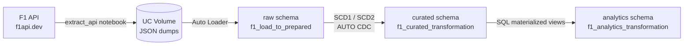
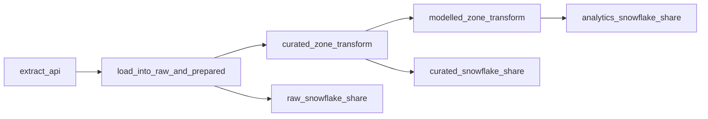
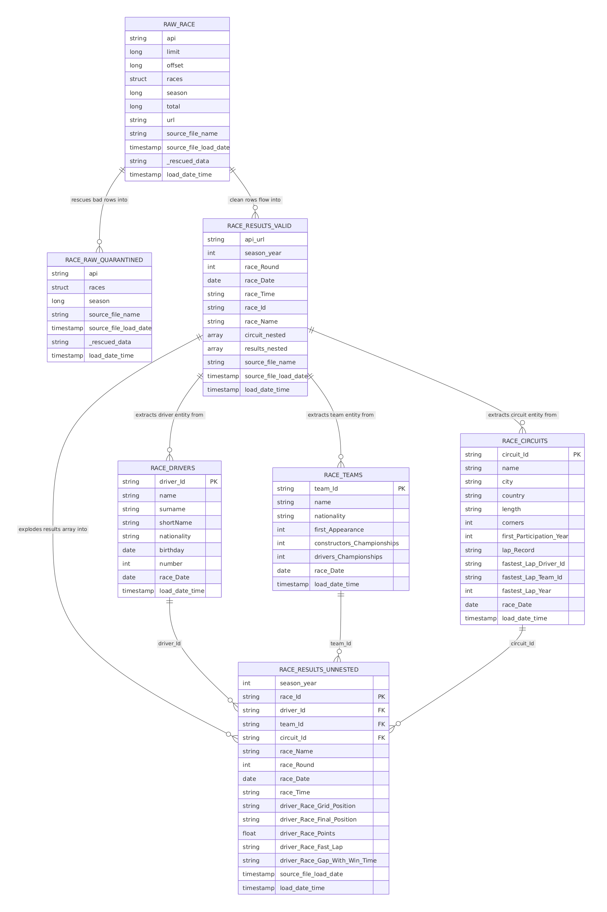
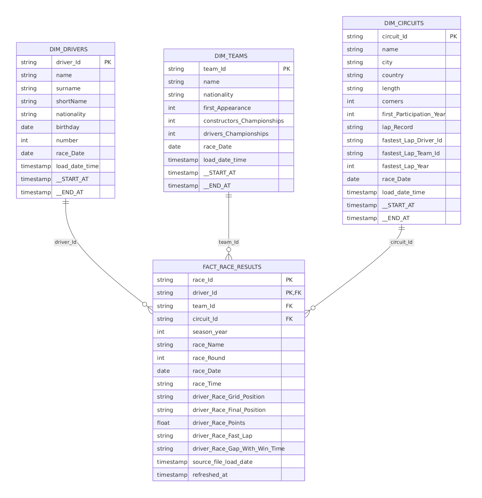
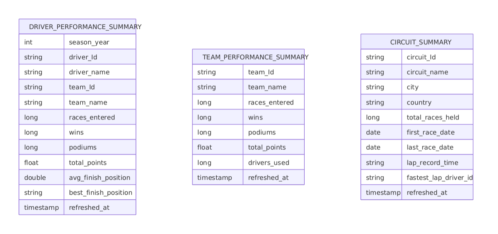

# F1 Databricks Lakehouse

An end-to-end Formula 1 race data pipeline built on Databricks, using **Spark Declarative Pipelines** (Lakeflow) and the **Medallion Architecture**. Race results are pulled from a public F1 API, then flow through raw → curated → analytics zones, ending in queryable driver, team, and circuit performance summaries.

Deployed entirely as a [Databricks Asset Bundle](https://docs.databricks.com/aws/en/dev-tools/bundles/) — one `databricks bundle deploy` stands up the catalog objects, three Lakeflow pipelines, and the orchestrating job.

## Architecture



Each zone is deployed as its own Lakeflow pipeline. A single Databricks Job
(`f1_ingest_and_transform_workflow`) runs the pipelines in sequence, with a
Snowflake sync task after each layer, running in parallel with the *next* layer's
transform rather than blocking it (syncing raw to Snowflake has no reason to wait on
the curated transform, for example):



| Zone | Pipeline | Key tables |
|---|---|---|
| Raw | `f1_load_to_prepared` | `raw_race`, `race_raw_quarantined`, `race_results_valid`, `race_results_unnested`, `race_drivers`, `race_teams`, `race_circuits` |
| Curated | `f1_curated_transformation` | `dim_drivers` (SCD2), `dim_teams` (SCD2), `dim_circuits` (SCD2), `fact_race_results` (SCD1) |
| Analytics | `f1_analytics_transformation` | `driver_performance_summary`, `team_performance_summary`, `circuit_summary` |

## Data model

Each medallion zone has its own ER diagram below, reflecting the tables that pipeline actually produces.

### Raw layer

`f1_load_to_prepared` — Auto Loader ingestion, quarantine, and flattening of the source JSON.

This project follows Databricks' documented **["Decouple ingestion with a scheduled job and Auto Loader"](https://docs.databricks.com/aws/en/ldp/api-ingestion#pattern-decoupled-autoloader)** pattern for pulling data from an arbitrary API. `extract_f1_source_data.ipynb` runs as a separate job task, calls `f1api.dev`, and lands the raw JSON in a Unity Catalog volume — it never runs inside the pipeline itself. `f1_load_to_prepared`'s `raw_race` table only reads files from that volume with Auto Loader. The pipeline never talks to the API, and the job never touches transformation logic. That separation is what buys Auto Loader's exactly-once file tracking and keeps `f1api.dev`'s pagination/rate-limit handling out of the declarative pipeline code entirely.

Every raw table carries two timestamps, and the distinction matters: `load_date_time` is stamped with `current_timestamp()` at pipeline run time, so every row in the same Auto Loader micro-batch gets an identical value. `source_file_load_date` comes from Auto Loader's `_metadata.file_modification_time` instead — the file's own timestamp — and is what downstream SCD2 sequencing actually relies on to tell rows apart within a batch.



### Curated layer

`f1_curated_transformation` — the conformed star schema. Dimensions are maintained as **SCD Type 2** (full history, via `dp.create_auto_cdc_flow`), the fact table as **SCD Type 1** (latest state only).

Dimension SCD2 flows sequence on `race_Date`, not a load timestamp — `race_Date` reflects when the underlying event actually happened, so a driver's record updates in race-chronological order regardless of the order files happen to get processed in.



### Modelled (analytics) layer

`f1_analytics_transformation` — gold materialized views built off the curated fact and dimension tables (`CREATE OR REFRESH MATERIALIZED VIEW` in `src/transformations/modelled/*.sql`). A materialized view's Iceberg metadata normally attaches only to its hidden internal backing table, not the queryable name — which is exactly what external readers like Snowflake need. Databricks' external-access-for-pipelines feature closes that gap: the `pipelines.externalMetadata.enabled` table property (set in `TBLPROPERTIES` alongside the usual UniForm properties) makes Unity Catalog serve Iceberg metadata for the MV's queryable name itself.



## Repository structure

```
.
├── AGENTS.md
├── CLAUDE.md
├── README.md
├── databricks.yml                             # Bundle definition, dev/prod targets & variables
├── fixtures/
├── resources/
│   ├── databricks_entity_creation/
│   │   └── base_objects_creation.yml          # Catalog schemas + UC volume
│   ├── job_definitions/
│   │   └── f1_ingest_and_transform_workflow.yml   # The orchestrating job
│   └── transformation_pipelines/
│       ├── f1_load_to_prepared.yml            # Raw pipeline definition
│       ├── f1_curated_transformation.yml      # Curated pipeline definition
│       └── f1_analytics_transformation.yml    # Analytics pipeline definition
└── src/
    ├── ingestion/
    │   └── extract_f1_source_data.ipynb       # Pulls race data from f1api.dev
    ├── transformations/
    │   ├── prepared/
    │   │   └── race_data_load_raw_and_prepared.py   # Bronze: Auto Loader ingestion + flattening
    │   ├── curated/
    │   │   └── race_data_curated.py           # Silver: SCD1/SCD2 dimensional model
    │   └── modelled/
    │       ├── driver_performance_summary.sql # Gold: driver aggregates
    │       ├── team_performance_summary.sql   # Gold: team aggregates
    │       └── circuit_summary.sql            # Gold: circuit aggregates
    └── utility/
        ├── utiltiy_notebook.ipynb                     # One-off catalog setup notebook
        ├── create_snowflake_catalog_integration.ipynb # One-time: creates the Snowflake catalog integration
        ├── sync_to_snowflake.ipynb         # Per-run: creates/refreshes every synced ICEBERG TABLE
        └── snowflake_sync_config.json                 # Declarative source→target table mapping the notebook above reads
```

## Prerequisites

- A Databricks workspace with Unity Catalog enabled
- [Databricks CLI](https://docs.databricks.com/dev-tools/cli/install.html) v0.240+
- Permissions to create catalogs, schemas, and volumes

## Setup

### 1. Create a personal access token

1. In your Databricks workspace, go to **Profile → Settings**, then under the **User** section open the **Developer** subsection. Click **Manage** next to **Access tokens**.
2. Click **Generate new token**, enter a **Lifetime (days)**, and set **Scope** to **Other APIs**.
3. For **API scope(s)**, choose **All APIs**.
4. Copy the generated token — you won't be able to view it again.

### 2. Clone and authenticate

```bash
git clone https://github.com/vikneshwara-r-b/f1-databricks-lakehouse.git
cd f1-databricks-lakehouse
databricks auth login --host https://<your-workspace-url>
```

When prompted, paste in the personal access token generated above.

### 3. Review variables

Check `databricks.yml` for the `dev` target — by default it deploys into the `workspace` catalog with `raw` / `curated` / `analytics` schemas. Adjust `catalog` or schema names as needed. The workspace itself is whichever one you authenticated against in Step 2 — `databricks.yml` doesn't pin a `host`, so switching workspaces is just a matter of re-running `databricks auth login` against a different one.

### 4. Create the catalog

The bundle creates the `raw` / `curated` / `analytics` **schemas** and the raw volume inside whichever catalog you point it at (see `resources/databricks_entity_creation/base_objects_creation.yml`) — but it does not create the **catalog** itself.

- **`dev` target:** no action needed. It uses the built-in `workspace` catalog, which every Unity Catalog–enabled workspace already has.
- **`prod` target (or any custom catalog name):** the catalog is now provisioned by Terraform (`terraform/`), with external S3 storage — see `terraform/README.md` for setup and the ["Deploying to production"](#deploying-to-production) steps below. This replaces the old `src/utility/utiltiy_notebook.ipynb`-based manual step for `prod`; that notebook is kept around only as a legacy/manual fallback (e.g. for non-AWS environments) and does exactly one thing: `CREATE CATALOG IF NOT EXISTS <catalog_name>`.

### 5. Validate and deploy

```bash
databricks bundle validate -t dev
databricks bundle deploy -t dev
```

This creates the schemas and volume, the three Lakeflow pipelines, and the orchestrating job (prefixed `[dev <your_databricks_username>]` in development mode).

### 6. Run the pipeline

```bash
databricks bundle run f1_ingest_and_transform_workflow -t dev
```

Optionally override job parameters to pull a different race:

```bash
databricks bundle run f1_ingest_and_transform_workflow -t dev \
  --params f1_season_year=2023,f1_season_round=5
```

### 7. Query the results

```sql
SELECT driver_name, team_name, wins, podiums, total_points
FROM workspace.analytics.driver_performance_summary
ORDER BY total_points DESC;
```

## Deploying to production

Production deploys the `prod` target into a dedicated `f1_analytics` catalog (backed by
external S3 storage) and, on top of that, makes the 3 gold/analytics tables readable
directly from Snowflake (UniForm + Iceberg REST Catalog + credential vending — see
["How the Snowflake federation works"](#how-the-snowflake-federation-works) below for
the architecture). Terraform here is **one project, one state** — AWS storage, the
Unity Catalog catalog, the Databricks service principal, the Snowflake role, and both
Secrets Manager secrets, all from a single `terraform apply`.

### 1. Prerequisites

- A named AWS CLI profile and a named Databricks CLI profile, both pointed at the
  right account/workspace: `databricks auth login --host https://<prod-workspace-url> --profile <profile-name>`.
- A metastore admin must enable Unity Catalog's `external_access_enabled` setting on
  the metastore (Public Preview) — required for credential vending to work at all;
  without it, Snowflake fails with "Please ensure that the catalog vends credentials."
  It's a *workspace* Catalog Explorer setting, not an Account Console one (gear icon
  → Metastore → Details → External data access), visible only to sufficiently
  privileged users and off by default for security — the CLI is more reliable. Get
  your metastore id with `databricks metastores current --profile
  <your-databricks-cli-profile>`, then:
  `databricks metastores update <metastore-id> --external-access-enabled=true
  --profile <your-databricks-cli-profile>`. Deliberately kept manual rather than
  Terraform-managed, since the metastore is shared across workspaces this project
  doesn't own (see `terraform/README.md` Prerequisites for the full rationale).
- [Terraform](https://developer.hashicorp.com/terraform/install) >= 1.6, and the AWS
  CLI configured with the profile above.
- Whoever runs `databricks bundle deploy -t prod` needs the **"Service principal:
  User"** role on `svc-f1-analytics-automation` (the SP the job/pipelines
  `run_as`) — being a workspace admin, or the user who created the SP, does **not**
  imply this role. `terraform apply` grants it automatically (to whichever identity
  `var.databricks_profile` authenticates as), via
  `databricks_access_control_rule_set.snowflake_reader_user`; see
  `terraform/README.md` Prerequisites item 4 for the manual fallback and the
  authoritative-overwrite caveat on that resource.

### 2. Set up the Snowflake admin identity Terraform authenticates as

Terraform needs a Snowflake identity of its own to bootstrap everything else — this is
the one Snowflake credential that genuinely can't be automated, since it's what
Terraform uses to create everything downstream (including the sync service user).
Rather than using your own personal account, create a dedicated, generically-named
service user (key-pair auth only — no username/password anywhere in this setup) as a
human `ACCOUNTADMIN`, one time:
```bash
openssl genrsa 2048 | openssl pkcs8 -topk8 -inform PEM -out admin_rsa_key.p8 -nocrypt
openssl rsa -in admin_rsa_key.p8 -pubout -out admin_rsa_key.pub
grep -v -e '^-----' admin_rsa_key.pub | tr -d '\n'   # paste into the CREATE USER below
```
```sql
CREATE USER SVC_IAC_ADMIN
  TYPE = SERVICE
  RSA_PUBLIC_KEY = '<public key body from above>'
  COMMENT = 'Dedicated infrastructure-automation identity';

GRANT ROLE SECURITYADMIN TO USER SVC_IAC_ADMIN;
GRANT ROLE SYSADMIN TO USER SVC_IAC_ADMIN;
GRANT CREATE INTEGRATION ON ACCOUNT TO ROLE SECURITYADMIN WITH GRANT OPTION;
```
It only needs these two roles, not `ACCOUNTADMIN` itself — the last grant is a
one-time exception needed because Snowflake restricts granting account-level
privileges like `CREATE INTEGRATION` to `ACCOUNTADMIN` or a role holding it
`WITH GRANT OPTION`, not just `MANAGE GRANTS`. Full detail in
[`terraform/README.md`](terraform/README.md#prerequisites-one-time-manual).
Have `SVC_IAC_ADMIN` and `admin_rsa_key.p8`'s contents ready for the next step — they
go into `terraform.tfvars` as `snowflake_admin_user` / `snowflake_admin_private_key_pem`.

### 3. Apply Terraform

```bash
cd terraform
cp terraform.tfvars.example terraform.tfvars   # fill in — this file holds raw key material
terraform init
terraform apply
```

This creates the S3 bucket and IAM role backing the catalog's storage, both Secrets
Manager secrets (the admin identity from step 2, and a **Snowflake service user
Terraform generates and creates itself** — key pair included, see
[`terraform/README.md`](terraform/README.md#the-snowflake-service-user-and-its-role-fully-automated)
— no manual `CREATE USER` needed), the storage credential, external location, the
`f1_analytics` catalog itself, the Databricks service principal + a **catalog-level**
grant (`USE CATALOG`/`USE SCHEMA`/`SELECT`/`EXTERNAL USE SCHEMA`, which cascades to
every schema inside the catalog — including `analytics`, before it even exists yet),
the Snowflake role + grants, and the Databricks secret scope the sync notebook reads
from. One apply, no second pass needed — granting at the catalog level means nothing
here has to wait on the DAB bundle to create anything first. Delete/secure
`terraform.tfvars` once applied.

### 4. Deploy the bundle, bootstrap the catalog integration once, then run

```bash
cd ..
databricks bundle deploy -t prod
```

Run `src/utility/create_snowflake_catalog_integration.ipynb` **manually, once** in the
workspace — it creates the Snowflake catalog integration. Not a job task, since it
only needs to exist once; skipping it means the next step fails with no integration to
create Iceberg tables against.

```bash
databricks bundle run f1_ingest_and_transform_workflow -t prod
```

This creates the `raw`/`curated`/`analytics` schemas and volume inside the catalog
Terraform just created, runs the three Lakeflow pipelines, and — right after each
one — runs that layer's `{raw,curated,analytics}_snowflake_share` task,
which creates/refreshes that layer's `ICEBERG TABLE` objects against the integration
from the step above.

#### Forcing a full refresh of all three pipelines

Normal runs are incremental. To force every Lakeflow pipeline to fully refresh,
deploy with the `full_refresh_all` bundle variable set, run the job, then redeploy
without it:

```bash
databricks bundle deploy -t prod --var="full_refresh_all=true"
databricks bundle run f1_ingest_and_transform_workflow -t prod
databricks bundle deploy -t prod        # back to incremental (the default is false)
```

This is a **deploy-time** flag, not a runtime one, so it costs two deploys per use.
That is a Databricks Jobs constraint rather than a shortcut: `pipeline_task.full_refresh`
is a boolean field that does not accept `{{job.parameters.x}}` substitution, and the
legacy `pipeline_params` override is rejected on jobs that declare job-level
`parameters:`, which this job does. Both were confirmed against the live API.

One consequence worth knowing: a full refresh rebuilds each table's underlying
storage, which changes its Iceberg table UUID. Snowflake's existing `ICEBERG TABLE`
objects are pinned to the previous UUID, so `ALTER ICEBERG TABLE ... REFRESH` fails
afterwards. `sync_to_snowflake.ipynb` detects that specific error and drops and
recreates the affected Snowflake table automatically, so the sync tasks recover on
their own.

### 5. Verify

```bash
databricks catalogs get f1_analytics
databricks storage-credentials get <storage_credential_name>   # from terraform output
aws iam get-role --role-name uc-f1_analytics-storage-role --profile <aws-profile>
```

In Databricks SQL, confirm UniForm persisted:

```sql
SHOW TBLPROPERTIES f1_analytics.analytics.driver_performance_summary;
```

In Snowflake:

```sql
SHOW CATALOG INTEGRATIONS;
SHOW ICEBERG TABLES;
SELECT * FROM <snowflake_db>.<schema>.driver_performance_summary LIMIT 10;
```

Full prerequisite detail, the exact Snowflake service-user setup commands, and the list
of still-unverified Public Preview details (exact Snowflake catalog-integration syntax,
UniForm-on-materialized-view persistence) are all in
[`terraform/README.md`](terraform/README.md).

## How the Snowflake federation works

Nearly every table across all three schemas — `raw` (6 of 7; `race_raw_quarantined`
is deliberately excluded, see below), `curated` (4), and `analytics` (3 gold tables:
`driver_performance_summary`, `team_performance_summary`, `circuit_summary`) — is
readable directly from Snowflake, following [Databricks' UniForm + Iceberg REST Catalog pattern](https://www.databricks.com/blog/read-unity-catalog-tables-in-snowflake):

1. Every synced table has UniForm enabled plus `pipelines.externalMetadata.enabled = 'true'` (`table_properties`/`TBLPROPERTIES` in `src/transformations/{prepared,curated,modelled}/*`). That property is what makes Unity Catalog serve Iceberg metadata for each table's queryable name — for the gold layer's materialized views specifically, Iceberg metadata otherwise attaches only to the MV's hidden internal backing table, not the name Snowflake queries, so without this property Snowflake sees "not an Iceberg compatible table" even though UniForm is otherwise correctly enabled.
2. `terraform/` provisions a Databricks service principal (OAuth M2M) with `EXTERNAL USE SCHEMA`/`EXTERNAL USE LOCATION` grants for Unity Catalog's credential vending, plus `MODIFY`/`CREATE TABLE`/`CREATE MATERIALIZED VIEW`/`READ VOLUME`/`WRITE VOLUME` so the same principal can also run the job (see below) — `CREATE MATERIALIZED VIEW` is a separate privilege from `CREATE TABLE`, required specifically for the gold layer; the AWS storage the catalog depends on; a single KMS-encrypted Secrets Manager secret holding every Snowflake credential involved; and a Databricks secret scope holding everything the next step needs.
3. `src/utility/create_snowflake_catalog_integration.ipynb` creates the Snowflake-side catalog integration — run manually, once, not part of any job, since it only needs to exist once.
4. The `f1_ingest_and_transform_workflow` job runs a `{raw,curated,analytics}_snowflake_share` task right after each layer's own pipeline (not once at the end) — three invocations of the same `src/utility/sync_to_snowflake.ipynb` notebook, each passed a different `layer` widget value. Each one connects to Snowflake as the same dedicated service user (key-pair auth) to create/refresh an `ICEBERG TABLE` for every entry under that layer's key in `src/utility/snowflake_sync_config.json` — the declarative mapping of source table → target Snowflake schema/table that replaced the earlier gold-only, hardcoded table list. A Snowflake Iceberg table backed by an external REST catalog always mirrors its source's full schema (Snowflake has no column-subset option for this table type), so the config has no column list — it's purely a sync target list. `race_raw_quarantined` has no entry under `raw` — quarantined/rejected records aren't meant to be externally readable. Target schemas (`RAW`/`CURATED`/`ANALYTICS`) are created by Terraform (`terraform/snowflake_data.tf`). An already-existing table only actually gets refreshed (`ALTER ICEBERG TABLE ... REFRESH`) if its Databricks source actually changed in the layer's pipeline's latest update — one `event_log(pipeline_id)` call per layer (`GROUP BY flow_name`, the `pipeline_id` passed in directly from the job's own `resources.pipelines.*.id`), not one call per table and not a custom state table, using different signals for streaming tables (incremental row-count metrics) versus materialized views (the `planning_information` event's chosen maintenance technique — an MV's `num_output_rows` is always its full recomputed row count, so it's useless as a change signal on its own). A newly-created table is always refreshed once regardless.
5. The job itself runs as a dedicated Databricks service principal, not whichever human deploys the bundle (`run_as` on the `prod` target in `databricks.yml`) — reusing the same OAuth M2M service principal from step 2 rather than a separate job-runner identity, so its catalog/volume/secret-scope grants cover both what Snowflake's integration needs and what the job's own notebook/pipeline tasks need. `run_as` only changes who *executes* the job, though — it doesn't grant that identity access to the workspace files (notebooks) the bundle deploys, which otherwise stay owned by whoever ran `databricks bundle deploy`. The `prod` target's top-level `permissions` block grants the SP (and the `admins` group, covering whichever human deploys) `CAN_MANAGE` on everything the bundle deploys, resources and files alike — without it, the job fails at run time with "Unable to access the notebook ... lacks the required permissions."

## Tech stack

- **Databricks Lakeflow (Spark Declarative Pipelines)** — `pyspark.pipelines` (`dp`) for the raw and curated layers; SQL materialized views (`pipelines.externalMetadata.enabled` + UniForm `TBLPROPERTIES`) for the analytics layer, so Iceberg exposure to external readers works even though the gold tables stay materialized views
- **Auto Loader** (`cloudFiles`) for incremental JSON ingestion, with schema rescue for malformed records
- **`dp.create_auto_cdc_flow`** for SCD Type 1 / Type 2 dimensional modeling
- **Databricks Asset Bundles** for all deployment and orchestration — no manual cluster or job setup
- **Unity Catalog** for schema, volume, and table governance

## Data source

Race data is sourced from the [f1api.dev](https://f1api.dev) public API.